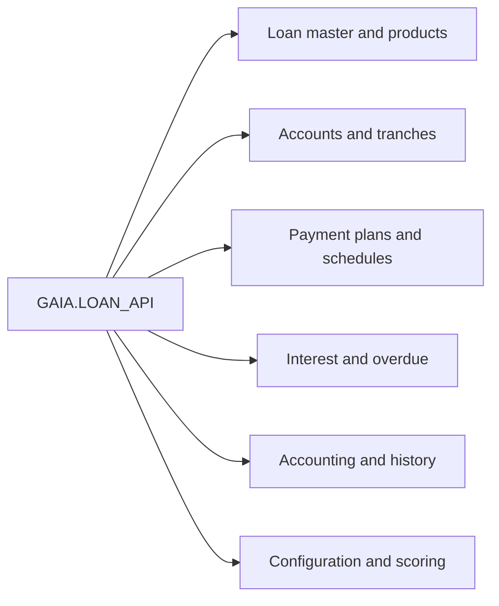

# LOAN_API — Data Model & Database Access Register

[← Overview](index.md) · [API Reference](api.md) · [Dependencies](dependencies.md) · [Error Handling](error-handling.md)

## Purpose and provenance

This document covers the database objects identified across **all 89 public API entries** in the source-derived [API Reference](api.md), rather than only selected examples. The register reports method-level static SQL associations extracted during documentation generation. It is an **access and impact map**, not the target database's authoritative schema definition.

**Important:** `READ` indicates observed SELECT-style access. `WRITE` is a conservative umbrella label where the extraction does not reliably distinguish INSERT, UPDATE or DELETE. The columns below must not be used to assert exact DML semantics without inspecting the linked source method. Private routines, external packages, views, triggers, synonyms and dynamic SQL may add further effects.

## Database access overview

| Measure | Static documentation result |
|---|---:|
| Public method entries assessed | 89 |
| Named database objects mapped to public methods | 46 |
| Functional object groups | 7 |
| Physical key and foreign-key constraints | Not verified — schema DDL required |



The arrows represent data domains touched by the package, **not** physical foreign-key constraints.

## Object inventory by business domain

### Loan core and product data

| Object | Observed access | Role in loan processing | Public API usage |
|---|---|---|---|
| `KRD_TEKLIF` | READ | Loan offer header/state | [init_global_variables](api.md#init-global-variables) |
| `KRD_TEKLIF_DETAY` | READ, WRITE | Loan master/detail attributes and contract state | [do_loan_control](api.md#do-loan-control-1), [do_loan_control](api.md#do-loan-control-2), [init_global_variables](api.md#init-global-variables), [create_account](api.md#create-account), [do_Loan_Close_With_Collateral_Out](api.md#do-loan-close-with-collateral-out), [change_account_status](api.md#change-account-status), [do_Auto_Payment](api.md#do-auto-payment), [Get_Delay_Int_Rate](api.md#get-delay-int-rate), [get_ovd_date](api.md#get-ovd-date) and 3 more (see API index) |
| `KRD_TEKLIF_NO` | WRITE | Referenced loan-processing or supporting data object; exact schema purpose requires DDL review | [get_offer_id](api.md#get-offer-id) |
| `KRD_TESIS` | READ, WRITE | Loan setup/facility information | [init_global_variables](api.md#init-global-variables), [create_account](api.md#create-account), [do_guarantee_out](api.md#do-guarantee-out), [do_non_cash_loan_close](api.md#do-non-cash-loan-close), [do_com_schedule_allignment](api.md#do-com-schedule-allignment), [do_commission_recognition](api.md#do-commission-recognition) |
| `LOAN_FLOW_RATIO_INFO` | READ | Historical/period-based loan interest flow-rate information | [get_flow_ratio_info](api.md#get-flow-ratio-info), [table_log_operation](api.md#table-log-operation) |
| `LOAN_STOP_RATIO_INFO` | READ | Interest stop-rate or suspension intervals | [get_stop_ratio_info](api.md#get-stop-ratio-info) |

### Accounts, tranches and portfolio

| Object | Observed access | Role in loan processing | Public API usage |
|---|---|---|---|
| `CS_ACCOUNT` | READ, WRITE | Account balances and linked banking accounts | [get_loan_amount](api.md#get-loan-amount), [do_loan_collateral_out](api.md#do-loan-collateral-out), [do_non_cash_loan_close](api.md#do-non-cash-loan-close), [change_account_status](api.md#change-account-status), [do_com_schedule_allignment](api.md#do-com-schedule-allignment), [get_ovd_date](api.md#get-ovd-date), [get_ovd_date_old](api.md#get-ovd-date-old), [get_new_ov_cont_no](api.md#get-new-ov-cont-no), [do_journal_control](api.md#do-journal-control) and 1 more (see API index) |
| `LOAN_PORTFOLIO_LITE` | READ | Referenced loan-processing or supporting data object; exact schema purpose requires DDL review | [do_loan_status_control](api.md#do-loan-status-control), [do_Loan_Close_With_Collateral_Out](api.md#do-loan-close-with-collateral-out) |
| `LOAN_TRANCHE_INFO` | READ | Tranche information | [add_column_update](api.md#add-column-update-1) |

### Payment plans and schedules

| Object | Observed access | Role in loan processing | Public API usage |
|---|---|---|---|
| `CREATE_SCHEDULE_PARAMETRS` | READ | Referenced loan-processing or supporting data object; exact schema purpose requires DDL review | [get_created_schedule](api.md#get-created-schedule) |
| `KRD_KOM_EOD` | READ, WRITE | Referenced loan-processing or supporting data object; exact schema purpose requires DDL review | [do_commission_recognition](api.md#do-commission-recognition) |
| `KRD_KOM_PLAN_DETAY` | READ, WRITE | Referenced loan-processing or supporting data object; exact schema purpose requires DDL review | [do_com_schedule_allignment](api.md#do-com-schedule-allignment), [do_commission_recognition](api.md#do-commission-recognition) |
| `KRD_ODEME_PLAN` | READ | Repayment planning information | [init_global_variables](api.md#init-global-variables) |
| `KRD_SCOR_ODEME_PLAN` | READ | Referenced loan-processing or supporting data object; exact schema purpose requires DDL review | [get_schedule_from_memo](api.md#get-schedule-from-memo) |
| `LOAN_PAYMENT_PLAN` | READ, WRITE | Installment amounts, paid/remaining plan data and due dates | [do_Auto_Payment](api.md#do-auto-payment), [get_next_Plan_Pym](api.md#get-next-plan-pym), [do_schedule_allignment](api.md#do-schedule-allignment), [get_grace_info](api.md#get-grace-info), [get_Annuity_Amount](api.md#get-annuity-amount), [get_Pym_Startdate](api.md#get-pym-startdate), [is_Payment_Date](api.md#is-payment-date), [get_ovd_date](api.md#get-ovd-date), [get_ovd_date_old](api.md#get-ovd-date-old) and 1 more (see API index) |
| `ODEME_PLAN_TMP2` | READ, WRITE | Referenced loan-processing or supporting data object; exact schema purpose requires DDL review | [get_special_schedule](api.md#get-special-schedule) |

### Interest, overdue and batch controls

| Object | Observed access | Role in loan processing | Public API usage |
|---|---|---|---|
| `EOD_PROGRAMS_EXCEPTION` | READ | EOD exception exclusions | [do_Auto_Payment](api.md#do-auto-payment) |
| `LOAN_EOD_AUTO_CLOSE` | READ, WRITE | Referenced loan-processing or supporting data object; exact schema purpose requires DDL review | [do_Loan_Close_With_Collateral_Out](api.md#do-loan-close-with-collateral-out) |
| `LOAN_EOD_CONTROL` | READ, WRITE | Loan control processing state | [do_loan_control](api.md#do-loan-control-1), [do_loan_control](api.md#do-loan-control-2) |
| `LOAN_EOD_CONTROL_EXP` | READ | Loan control exemptions | [do_plan_control](api.md#do-plan-control), [do_loan_control](api.md#do-loan-control-2) |
| `SP_FAIZ_GUN_TANIM_PR` | READ | Referenced loan-processing or supporting data object; exact schema purpose requires DDL review | [create_account](api.md#create-account) |

### History, logging and accounting

| Object | Observed access | Role in loan processing | Public API usage |
|---|---|---|---|
| `GL_JOURNAL_LINES` | READ | Accounting journal detail | [do_delete_operation](api.md#do-delete-operation), [update_loan_history](api.md#update-loan-history) |
| `GLBL_TRANSACTION` | READ, WRITE | Transaction processing metadata | [do_delete_operation](api.md#do-delete-operation), [do_create_tranche](api.md#do-create-tranche) |
| `LOAN_FLOW_RATIO_INFO_LOG` | READ, WRITE | Rate-flow history logging | [table_log_operation](api.md#table-log-operation) |
| `LOAN_HISTORY_MAPPING` | READ | Mapping tags to recorded and reversible attributes | [add_column_update](api.md#add-column-update-1) |
| `LOAN_INT_CALCULATION_DIFF_HISTORY` | READ, WRITE | Difference/calculation records in interest processing | [loan_int_diff_operation](api.md#loan-int-diff-operation) |
| `LOAN_OPERATION_HISTORY` | READ, WRITE | Transaction-level loan history and reversal metadata | [do_delete_operation](api.md#do-delete-operation), [do_loan_control](api.md#do-loan-control-2), [update_loan_history](api.md#update-loan-history), [get_additional_info](api.md#get-additional-info) |
| `LOAN_OPERATION_VOUCHER` | READ | Voucher configuration or operation data | [create_journal_entries](api.md#create-journal-entries) |
| `LOAN_PAYMENT_PLAN_LOG` | READ, WRITE | Snapshot or audit of payment plan | [table_log_operation](api.md#table-log-operation) |
| `LOAN_TRANCHE_LIMIT_CHANGES_HISTORY` | READ | History of credit-limit changes for tranches | [do_Loan_Close_With_Collateral_Out](api.md#do-loan-close-with-collateral-out) |
| `SS_MUH1201_0_LOG` | READ | Referenced loan-processing or supporting data object; exact schema purpose requires DDL review | [create_journal_entries](api.md#create-journal-entries) |

### Configuration and reference

| Object | Observed access | Role in loan processing | Public API usage |
|---|---|---|---|
| `GL_ACCOUNT_DEFINE` | READ | Referenced loan-processing or supporting data object; exact schema purpose requires DDL review | [get_gl_acc_active_passive](api.md#get-gl-acc-active-passive) |
| `KRD_TEMINAT_TIP_PR` | READ | Referenced loan-processing or supporting data object; exact schema purpose requires DDL review | [do_loan_collateral_out](api.md#do-loan-collateral-out) |
| `LOAN_ACC_TYPE_MAPPING` | READ | Referenced loan-processing or supporting data object; exact schema purpose requires DDL review | [get_acc_type_by_status](api.md#get-acc-type-by-status) |
| `LOAN_ACC_TYPES_PR` | READ | Account type and calculation group configuration | [create_account](api.md#create-account) |
| `LOAN_AMOUNT_RANGE_INFO` | READ | Referenced loan-processing or supporting data object; exact schema purpose requires DDL review | [get_amount_by_range](api.md#get-amount-by-range) |
| `LOAN_GLOBAL_PARAMETERS_PR` | READ | Referenced loan-processing or supporting data object; exact schema purpose requires DDL review | [get_gl_value](api.md#get-gl-value) |
| `LOAN_INT_CALC_TYPES_PR` | READ | Interest day-count or calculation convention configuration | [get_interest_calc_info](api.md#get-interest-calc-info), [get_basis_year_days_cnt](api.md#get-basis-year-days-cnt) |
| `LOAN_OPERATION_DESC` | READ | Loan operation mapping and transaction caller configuration | [create_journal_entries](api.md#create-journal-entries), [update_loan_history](api.md#update-loan-history) |
| `PKRD_TURKOD_PR` | READ | Loan product settings | [get_overdue_min_amount](api.md#get-overdue-min-amount), [get_overdue_grace_days](api.md#get-overdue-grace-days) |

### Collateral and credit evaluation

| Object | Observed access | Role in loan processing | Public API usage |
|---|---|---|---|
| `KRD_FON_VERILME` | WRITE | Referenced loan-processing or supporting data object; exact schema purpose requires DDL review | [do_Loan_Close_With_Collateral_Out](api.md#do-loan-close-with-collateral-out) |
| `KRD_SCOR_AUTO_C` | READ, WRITE | Referenced loan-processing or supporting data object; exact schema purpose requires DDL review | [do_loan_collateral_out](api.md#do-loan-collateral-out) |
| `KRD_SCOR_EMANET_C` | WRITE | Referenced loan-processing or supporting data object; exact schema purpose requires DDL review | [do_loan_collateral_out](api.md#do-loan-collateral-out) |
| `KRD_SCOR_ESYA_C` | WRITE | Referenced loan-processing or supporting data object; exact schema purpose requires DDL review | [do_loan_collateral_out](api.md#do-loan-collateral-out) |
| `KRD_SCOR_MAIN` | READ | Collateral/scoring master | [is_online_offer](api.md#is-online-offer) |
| `KRD_SCOR_REAL_ESTATE_C` | READ, WRITE | Referenced loan-processing or supporting data object; exact schema purpose requires DDL review | [do_loan_collateral_out](api.md#do-loan-collateral-out) |

## Cross-object relationships: logical, not physical

| Relationship | Evidence and significance |
|---|---|
| Loan detail → payment plan | Public methods use loan identifiers and dates while reading or updating repayment plan information. |
| Loan detail → customer accounts | Loan operations correlate contract/account data with balances and customer-linked account details. |
| Account types → payment plans | Account-type configuration determines whether and how amounts can be posted to schedules. |
| History → mapped updates | Additional transaction data and mapping records support reversible updates. |
| Product configuration → overdue/interest processing | Product-level thresholds and day-count settings influence calculation and transition rules. |

**Do not infer** PK/FK relationships, uniqueness, cascading actions, or table ownership from these logical descriptions.

## Additional direct source examples that need further method-to-object attribution

The uploaded Body also visibly references `LOAN_TRANCHE_PAYMENT_PLAN` in `post_int_amount_to_plan`; `KRD_GUARANTEE_MAIN`, `KRD_GUARANTEE_RELATIONS`, `KRD_GUARANTEE_C1` in `get_amount_for_pen_calc` overload 1; and `LOAN_CATEGORY` in `evaluate_limit_amount`. These illustrate that a method summary alone is **not an exhaustive SQL parser**.

| Object / group | Observed operation | Verified usage |
|---|---|---|
| `LOAN_TRANCHE_PAYMENT_PLAN` | SELECT, UPDATE | [post_int_amount_to_plan](api.md#post-int-amount-to-plan) |
| `KRD_GUARANTEE_MAIN`, `KRD_GUARANTEE_RELATIONS`, `KRD_GUARANTEE_C1` | SELECT | [get_amount_for_pen_calc — overload 1](api.md#get-amount-for-pen-calc-1) |
| `LOAN_CATEGORY` | SELECT | [evaluate_limit_amount](api.md#evaluate-limit-amount) |

## Verification checklist before operational release

- Reconcile all names with `ALL_OBJECTS`, `ALL_TAB_COLUMNS`, `ALL_CONSTRAINTS` and `ALL_CONS_COLUMNS` in the target schema.
- Re-run SQL parsing against all active **private** procedure/function bodies; this register links only public entry points.
- Verify direct versus delegated DML, dynamic SQL, triggers and transaction boundaries.
- Confirm whether each object is a TABLE, VIEW, SYNONYM or other schema object.

```sql
SELECT owner, object_name, object_type
  FROM all_objects
 WHERE owner = :schema_name
   AND object_name IN ('KRD_TEKLIF_DETAY','CS_ACCOUNT','LOAN_PAYMENT_PLAN',
                       'LOAN_OPERATION_HISTORY','LOAN_ACC_TYPES_PR')
 ORDER BY object_name;
```
