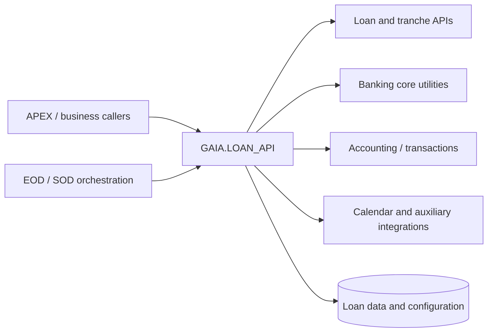

# LOAN_API — Dependencies & Integration Map

[← Overview](index.md) · [API Reference](api.md) · [Data Model](data-model.md)

## Scope

This register traces **qualified, named package/service references across all 89 public API entries** in the existing [API Reference](api.md). It replaces the former six-row example list with an indexed, cross-method view.

**Evidence level:** these are documentation-extracted qualified references. Most names correspond to callable PL/SQL packages, but their deployed object type and exact runtime contract require verification against the target schema. Textual extraction can confuse table aliases and package identifiers; suspicious names are not treated as verified standalone dependencies.

| Measure | Result |
|---|---:|
| Public method entries examined | 89 |
| Named qualified dependency candidates after obvious-alias filtering | 26 |
| Static and runtime dependency status | Not independently resolved against deployed database |
| Internal package calls | Some are linked in the API; complete call graph pending source-level analysis |

## Architecture and dependency domains



## Qualified service and package references

### Loan modules and APEX integration

| Qualified name | Functional responsibility / review note | Referenced by public API |
|---|---|---|
| `APEX_KRD2204_0_API_P` | APEX execution module integration | [do_Auto_Payment](api.md#do-auto-payment), [do_create_tranche](api.md#do-create-tranche) |
| `APEX_KRD2220_0_API_P` | APEX loan module integration | [do_guarantee_out](api.md#do-guarantee-out), [do_non_cash_loan_close](api.md#do-non-cash-loan-close) |
| `KRD_EOD` | Loan end-of-day and loan lifecycle operations | [do_delete_operation](api.md#do-delete-operation), [do_commission_recognition](api.md#do-commission-recognition) |
| `KRD2204_0_API` | Loan execution-related integration | [do_create_tranche](api.md#do-create-tranche) |
| `KRD2220_0_API` | Related loan business operation integration | [do_guarantee_out](api.md#do-guarantee-out), [do_non_cash_loan_close](api.md#do-non-cash-loan-close) |
| `LOAN_CATEGORY_API` | Loan category operations | [change_account_status](api.md#change-account-status) |
| `LOAN_REPORT_API` | Loan reporting and operation descriptions | [do_overdue_transit_operation](api.md#do-overdue-transit-operation), [evaluate_limit_amount](api.md#evaluate-limit-amount) |
| `LOAN_TRANCHE_API` | Tranche-related logging, processing and account/schedule operations | [do_delete_operation](api.md#do-delete-operation), [post_int_amount_to_plan](api.md#post-int-amount-to-plan), [do_Auto_Payment](api.md#do-auto-payment), [get_plan_payment_amount](api.md#get-plan-payment-amount), [get_ovd_date](api.md#get-ovd-date), [get_ovd_date_old](api.md#get-ovd-date-old), [do_create_tranche](api.md#do-create-tranche), [finalize_addtional_process](api.md#finalize-addtional-process), [update_loan_history](api.md#update-loan-history) |

### Shared banking platform services

| Qualified name | Functional responsibility / review note | Referenced by public API |
|---|---|---|
| `GLBL` | Global banking date, branch and session utilities | [do_loan_control](api.md#do-loan-control-2), [get_plan_error](api.md#get-plan-error), [loan_int_diff_operation](api.md#loan-int-diff-operation) |
| `GLBL_BAKIYE` | Account balance utilities | [do_guarantee_out](api.md#do-guarantee-out), [do_non_cash_loan_close](api.md#do-non-cash-loan-close), [do_Auto_Payment](api.md#do-auto-payment), [do_commission_recognition](api.md#do-commission-recognition) |
| `GLBL_CCY` | Currency and conversion utilities | [do_loan_collateral_out](api.md#do-loan-collateral-out), [do_Auto_Payment](api.md#do-auto-payment) |
| `GLBL_EOD` | End-of-day context and system transaction routines | [do_loan_collateral_out](api.md#do-loan-collateral-out), [do_Loan_Close_With_Collateral_Out](api.md#do-loan-close-with-collateral-out) |
| `GLBL_FAIZ` | Interest calculation utilities | [recalculate_int_payment_plan](api.md#recalculate-int-payment-plan), [get_special_schedule](api.md#get-special-schedule), [get_commission_schedule](api.md#get-commission-schedule), [get_Plan_Month_Count](api.md#get-plan-month-count), [get_Pym_Startdate](api.md#get-pym-startdate), [get_schedule_from_memo](api.md#get-schedule-from-memo), [do_int_calculation](api.md#do-int-calculation), [get_amount_for_pen_calc](api.md#get-amount-for-pen-calc-2) |
| `GLBL_FUNCTIONS` | Shared business helper functions | [do_journal_entry](api.md#do-journal-entry) |
| `GLBL_HESAP` | Account configuration and account management helpers | [do_Loan_Close_With_Collateral_Out](api.md#do-loan-close-with-collateral-out), [change_account_status](api.md#change-account-status), [get_gl_acc_from_matrix](api.md#get-gl-acc-from-matrix), [get_new_acc](api.md#get-new-acc), [evaluate_limit_amount](api.md#evaluate-limit-amount), [create_overdrafts](api.md#create-overdrafts), [do_journal_entry](api.md#do-journal-entry) |
| `GLBL_NAME` | Lookup of descriptive values | [create_account](api.md#create-account) |
| `GLBL_TARIH` | Calendar, date and business-day calculations | [create_account](api.md#create-account), [get_account_feature](api.md#get-account-feature), [get_commission_schedule](api.md#get-commission-schedule), [get_Pym_Startdate](api.md#get-pym-startdate), [is_Payment_Date](api.md#is-payment-date), [do_int_calculation](api.md#do-int-calculation), [do_commission_recognition](api.md#do-commission-recognition), [get_interest_calc_dates](api.md#get-interest-calc-dates), [get_interest_calc_dates_ex](api.md#get-interest-calc-dates-ex) |
| `GLOG` | Application logging | [do_com_schedule_allignment](api.md#do-com-schedule-allignment) |
| `GNI_MESSAGE` | Application/domain message and user feedback retrieval | [do_loan_status_control](api.md#do-loan-status-control), [create_account](api.md#create-account), [get_new_acc](api.md#get-new-acc), [get_commission_schedule](api.md#get-commission-schedule), [get_Pym_Startdate](api.md#get-pym-startdate) |
| `GNI_UTILITY` | Operational control and helper processing | [do_loan_control](api.md#do-loan-control-1), [do_Auto_Payment](api.md#do-auto-payment), [do_int_calculation](api.md#do-int-calculation), [do_overdue_transit_operation](api.md#do-overdue-transit-operation) |
| `TRN_BROKER` | Transaction identifiers and transaction initiation | [do_loan_collateral_out](api.md#do-loan-collateral-out), [do_guarantee_out](api.md#do-guarantee-out), [do_Loan_Close_With_Collateral_Out](api.md#do-loan-close-with-collateral-out), [do_non_cash_loan_close](api.md#do-non-cash-loan-close), [UPDATE_PAYMENT_PLAN](api.md#update-payment-plan), [do_journal_entry](api.md#do-journal-entry), [create_loan_history](api.md#create-loan-history) |

### Accounting and external services

| Qualified name | Functional responsibility / review note | Referenced by public API |
|---|---|---|
| `API_CALENDAR` | Calendar service | [UPDATE_PAYMENT_PLAN](api.md#update-payment-plan) |
| `API_VISTA` | External/service integration | [create_overdrafts](api.md#create-overdrafts) |
| `MM_ACCOUNTING#` | Accounting service; exact implementation not included | [do_delete_operation](api.md#do-delete-operation), [do_loan_collateral_out](api.md#do-loan-collateral-out), [do_journal_entry](api.md#do-journal-entry) |
| `PA_API#` | Accounting or payment support; exact role not determined | [do_loan_collateral_out](api.md#do-loan-collateral-out), [do_journal_entry](api.md#do-journal-entry) |

### Other named dependencies

| Qualified name | Functional responsibility / review note | Referenced by public API |
|---|---|---|
| `RUHA3H` | Qualified call candidate; implementation contract must be verified | [clear_addtional_data](api.md#clear-addtional-data), [add_additional_group](api.md#add-additional-group), [add_additional_info](api.md#add-additional-info-1), [add_column_update](api.md#add-column-update-1) |

## Source-observed additional integrations

The Package Body also contains source-visible Oracle and internal components that may not appear in the method-summary dependency register:

| Component | Responsibility | Scope |
|---|---|---|
| `DBMS_SQL` | Dynamic SQL parsing/execution | Voucher and mapped-update processing |
| `APEX_JSON` / `JSON_OBJECT_T` | JSON document handling | History and additional-information processing |
| `WWV_FLOW_COLLECTION` | APEX collection infrastructure | Depends on actual call context and APEX runtime |
| `LOAN_API` internal calls | Service-to-service orchestration | [evaluate_limit_amount](api.md#evaluate-limit-amount) invokes journal and history methods |

**Note:** This list is not proof that every listed Oracle/APEX component is an external deployment prerequisite for all methods. Run `ALL_DEPENDENCIES` in the target schema and inspect dynamic SQL to separate direct and transitive dependencies.

## Dependencies vs database objects

- [Data Model](data-model.md) records table/view access and observed DML.
- This page records external **qualified code references** and significant runtime facilities.
- A named routine may be public or private; an indirect call does not prove that a public caller always executes it.
- Access to a package can require privileges and compatible specification versions, which are not established from the supplied Body alone.

## Oracle metadata verification

```sql
SELECT referenced_owner, referenced_name, referenced_type
  FROM all_dependencies
 WHERE owner = :schema_name
   AND name = 'LOAN_API'
   AND type = 'PACKAGE BODY'
 ORDER BY referenced_owner, referenced_type, referenced_name;
```

To examine invalid referenced objects:

```sql
SELECT d.referenced_owner, d.referenced_name, o.status, o.object_type
  FROM all_dependencies d
  LEFT JOIN all_objects o
    ON o.owner = d.referenced_owner
   AND o.object_name = d.referenced_name
 WHERE d.owner = :schema_name
   AND d.name = 'LOAN_API'
   AND d.type = 'PACKAGE BODY'
 ORDER BY d.referenced_name, o.object_type;
```

**Unresolved checks:** dynamic references, synonyms, grants, transitive code effects, external network calls, package state and runtime error propagation.
