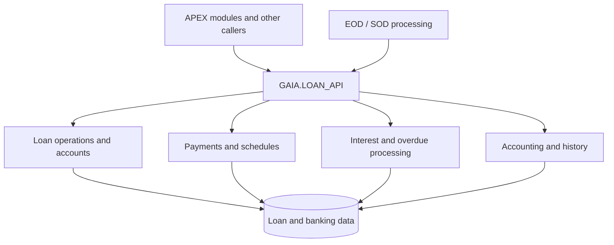

# LOAN_API | Package Overview

[← Loan Management](./modules/loan-management.md)

**Enterprise loan services · Oracle PL/SQL · Source-based technical reference**

---

## Overview

`GAIA.LOAN_API` is a shared banking service package that exposes procedures and functions for loan operations, accounts, payment allocation, repayment plans, interest and penalty calculations, overdue handling, credit limits, accounting journals, and transaction history.

It is not a single-screen controller. Multiple banking operations and supporting processes can use its public interfaces. The **Package Specification** defines the public contract; the **Package Body** is the primary source for verified business behavior and database effects.

### Package at a glance

| Item | Description |
|---|---|
| Package | `GAIA.LOAN_API` |
| Technology | Oracle Database / PL/SQL |
| Public API | **89 declarations:** 45 procedures and 44 functions (overloads counted separately) |
| Scope | Shared loan business operations and supporting services |
| Source of truth | Supplied Package Specification and Package Body |
| Audience | GNI Software developers, reviewers, and customer technical teams |
| Documentation status | Draft / Proof of Concept — further business-rule review required |

## Documentation guide

| Document | Why open it |
|---|---|
| [Workflows](workflows.md) | Understand the package's major capabilities through high-level visual diagrams |
| [Data Model](data-model.md) | Review important loan tables, verified access types, and method relationships |
| [Dependencies](dependencies.md) | Find relevant packages, integration calls and configuration dependencies |
| [API Reference](api.md) | Find public methods, exact signatures, parameters, business logic, rules and errors |
| [Error Handling](error-handling.md) | Understand selected application validation, configuration and processing failures |

## High-level architecture

*Conceptual capability map only — not a literal order of execution or a complete call graph.*

The [Workflows page](workflows.md) shows the earlier broad, cross-cutting diagrams for account creation, EOD/SOD processing and history/reversal.

## Functional map

The API is organized into **nine navigation domains**. These categories organize the reference; they are not separate independent modules.

| Functional domain | Business responsibility |
|---|---|
| [Loan operations and controls](api.md#domain-loan-operations-and-controls) | Coordinates loan operations, validation and control activities |
| [Accounts, guarantees and closure](api.md#domain-accounts-guarantees-and-closure) | Supports loan-linked accounts, collateral or guarantee activities and closure |
| [Payments and balances](api.md#domain-payments-and-balances) | Handles payment allocation, due amounts and account balances |
| [Payment schedules and dates](api.md#domain-payment-schedules-and-dates) | Generates or adjusts schedules, payment dates and grace-period information |
| [Interest, penalties and rates](api.md#domain-interest-penalties-and-rates) | Supplies rate information and interest/penalty calculations or operations |
| [Delinquency and status](api.md#domain-delinquency-and-status) | Evaluates overdue dates and supports delinquency transitions |
| [Limits, tranches and overdrafts](api.md#domain-limits-tranches-and-overdrafts) | Evaluates credit limits and handles tranche and overdraft operations |
| [Accounting and audit](api.md#domain-accounting-and-audit) | Resolves accounting mappings and creates or checks journal postings |
| [History, metadata and reversal](api.md#domain-history-metadata-and-reversal) | Records operation metadata and history and supports reversing mapped changes |

**GNI Software — LOAN_API Documentation** · [← Loan Management](./modules/loan-management.md)
