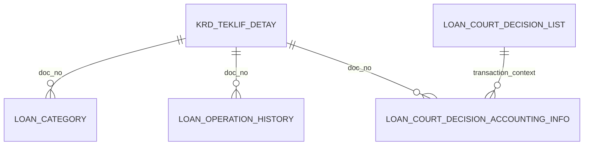

# LOAN_CATEGORY_API — Data Model & Database Access Register

[← Overview](loan-category-api.md) · [API Reference](loan-category-api-reference.md) · [Dependencies](loan-category-dependencies.md)

## Purpose and scope

A source-backed register of **principal business objects** in the category, court-decision, charge-off and collection workflows. This is not a physical schema definition or an exhaustive SQL inventory. READ and WRITE describe observed access within the supplied package and are not foreign-key assertions.

## Object inventory by business domain

| Object | Role in processing | Representative API |
|---|---|---|
| `SP_LOAN_SUB_CATEGORY_PR` | Configured category procedure dispatcher (`PROC_NAME`) | [run_loan_category](loan-category-api-reference.md#run-loan-category) |
| `LOAN_CATEGORY` | Category/subcategory records, current and end-dated state | [set_new_category](loan-category-api-reference.md#set-new-category) |
| `LOAN_CHARGE_OFF_PARAMETERS` | Active charge-off rules and configured selection SQL | [set_charge_off_status](loan-category-api-reference.md#set-charge-off-status) |
| `LOAN_CHARGE_OFF_LIST` | Candidates selected for charge-off processing | [set_charge_off_status](loan-category-api-reference.md#set-charge-off-status) |
| `KRD_TEKLIF_DETAY` | Loan master, contract and current status | [apply_court_decision](loan-category-api-reference.md#apply-court-decision), [do_close_operation](loan-category-api-reference.md#do-close-operation) |
| `LOAN_ACCOUNTS` | Loan component balances | [apply_court_decision](loan-category-api-reference.md#apply-court-decision) |
| `LOAN_COURT_DECISION_LIST` | Pending court decisions, debt component amounts and processing state | [apply_court_decision](loan-category-api-reference.md#apply-court-decision) |
| `LOAN_COURT_DECISION_ACCOUNTING_INFO` | Stored debit/credit items for legal-decision processing | [inst_accounting_data](loan-category-api-reference.md#inst-accounting-data), [fill_acc_tab](loan-category-api-reference.md#fill-acc-tab) |
| `SS_KRD22060_0_LOG` | Input and processing diagnostics for court decisions | [apply_court_decision](loan-category-api-reference.md#apply-court-decision) |
| `LOAN_OPERATION_HISTORY` | Existing payments and operations after court decision date | [apply_court_decision](loan-category-api-reference.md#apply-court-decision) |
| `LOAN_EOD_AUTO_CLOSE_PARAMETERS` / `LOAN_EOD_AUTO_CLOSE` | Configured closure selection and worklist | [do_close_operation](loan-category-api-reference.md#do-close-operation), [do_close_loans_ex](loan-category-api-reference.md#do-close-loans-ex) |
| `LOAN_PAYMENT_COLLECT_TEMP_LIST` | Candidate payment collection worklist | [collect_payment](loan-category-api-reference.md#collect-payment) |
| `LOAN_CATEGORY_EXCEPTION_LIST` | Exceptions affecting collection | [collect_payment](loan-category-api-reference.md#collect-payment) |
| `CS_ACCOUNT` | Account availability and balances | [collect_payment](loan-category-api-reference.md#collect-payment) |
| `LOAN_PORTFOLIO` | Loan type classification | [is_guaarantee](loan-category-api-reference.md#is-guaarantee) |
| `IBS.*` and `DWMAIN.DARHDOC_DBT` | Legacy payment and accounting movements | [has_payment](loan-category-api-reference.md#has-payment), [get_pymt_info_from_ibs](loan-category-api-reference.md#get-pymt-info-from-ibs) |

## Key logical joins

**Important:** these are conceptual associations inferred from the processing workflow. They are **not verified PK/FK relationships or cardinalities**. In particular, court decisions resolve the loan via contract number and may record generated transaction identifiers.

## Verification boundaries

- Physical constraints, indexes and synonym targets require database DDL/metadata checks.
- Configured SQL (`PARAM_QUERY`) and dynamic dispatch mean that a static table list cannot capture every possible runtime object.
- Posting via `LOAN_API` can affect further accounting/history objects not directly listed here.
