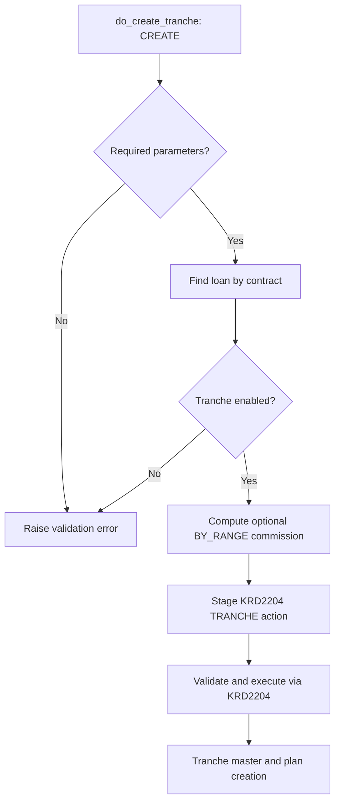
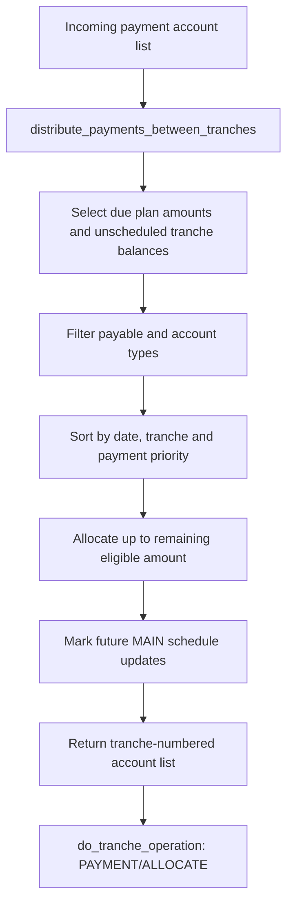
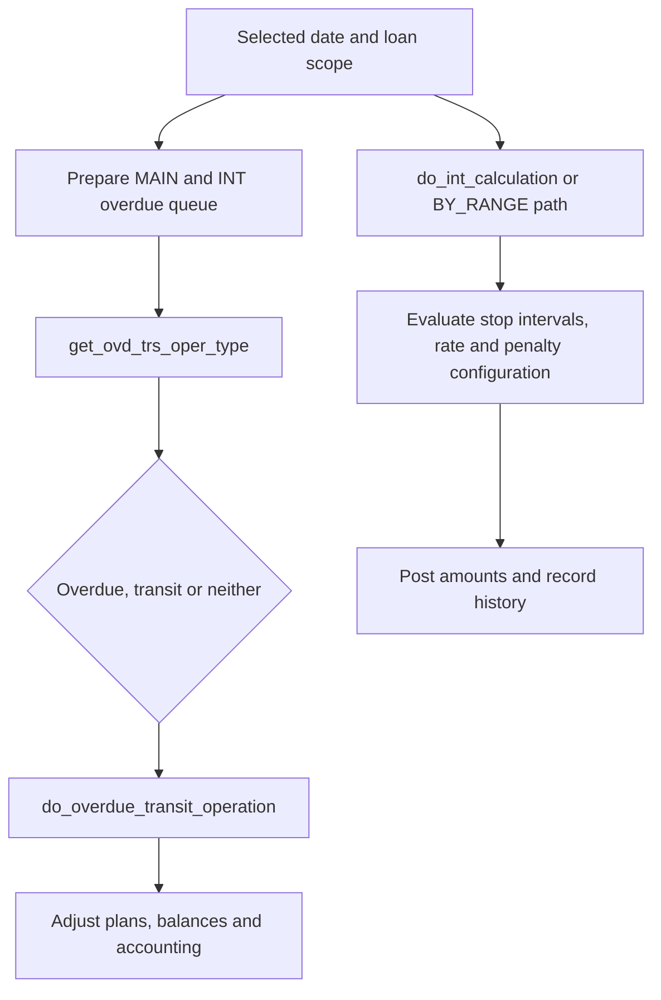
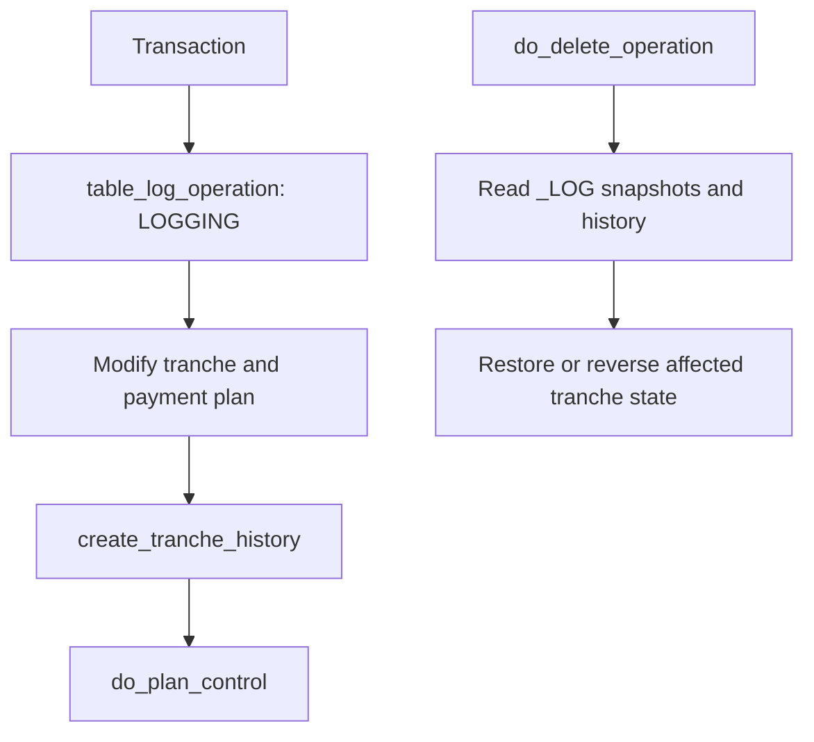

# LOAN_TRANCHE_API — Workflows

[← Overview](loan-tranche-api.md)

## Tranche creation

`create_tranche` separately uses base loan schedule and configured tranche terms. `do_merge_tranche` merges existing tranche state and adjusts related plan records when eligible.

## Allocate payments

The selection combines scheduled payment plan rows with an UNPIVOT view of tranche balances and orders by dates plus configured tranche priorities; it is more than an equal-proportion split.

## Overdue / transit and interest

## Reversal and validation

These diagrams express code-observed relationships rather than a guaranteed global sequence or transaction boundary.