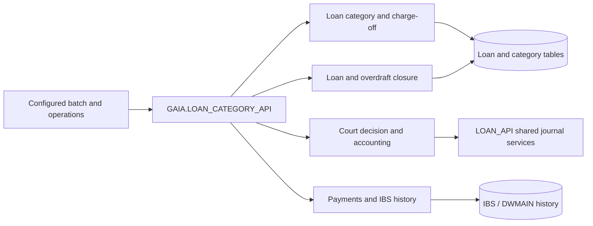

# LOAN_CATEGORY_API — Overview

[← Loan Management](../README.md)

`GAIA.LOAN_CATEGORY_API` coordinates category-related loan processing, court-decision debt adjustments, charge-off classification, automatic loan closure and payment collection. The package also reads legacy IBS transaction history when evaluating payments and legal decisions.

| Attribute | Value |
|---|---|
| Package | `GAIA.LOAN_CATEGORY_API` |
| Source | Supplied package specification and body |
| Public methods | **14: 11 procedures, 3 functions** |
| Implementation | Approximately 9,840 lines, including internal routines |
| Documentation status | Initial source-backed structure; detailed method review in progress |

## Documentation

| Page | Scope |
|---|---|
| [Workflows](workflows.md) | Primary category, court-decision and closure processing paths |
| [Data Model](data-model.md) | Principal source-visible objects and logical relationships |
| [Dependencies](dependencies.md) | Banking packages, transaction services and IBS data integration |
| [API Reference](api-reference.md) | All public routines, grouped by business responsibility |
| [Error Handling](error-handling.md) | Key validation and processing outcomes |

## Functional areas

| Area | Business responsibility | Public methods | API group |
|---|---|---:|---|
| **Category orchestration and classification** | Runs configured category jobs and maintains loan category states | 3 | [View](api-reference.md#domain-category-orchestration-and-classification) |
| **Court decisions and accounting** | Applies court decisions and constructs related accounting entries | 3 | [View](api-reference.md#domain-court-decisions-and-accounting) |
| **Charge-off and loan closure** | Executes configured loan closure flows | 2 | [View](api-reference.md#domain-charge-off-and-loan-closure) |
| **Payment collection and legacy IBS** | Collects payments and checks historical IBS payment information | 4 | [View](api-reference.md#domain-payment-collection-and-legacy-ibs) |
| **Overdraft and portfolio lookup** | Checks guarantee loan type and requests overdraft closure | 2 | [View](api-reference.md#domain-overdraft-and-portfolio-lookup) |

**Classification note:** these are documentation domains rather than physically separate PL/SQL modules.

## Business architecture

For detailed conditions and data updates, refer to the evolving [API Reference](api-reference.md).
