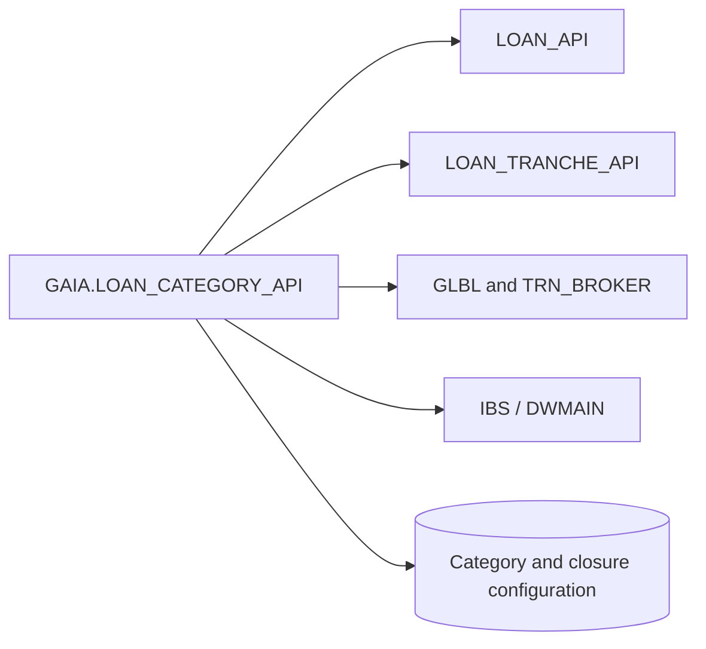

# LOAN_CATEGORY_API — Dependencies & Integration Map

[← Back to Overview](README.md)

## Scope

This register lists principal **source-visible** service and database integration dependencies. It does not assert deployed grants, transitive dependencies or every possible target of dynamic SQL.

## Architecture and dependency domains



## Qualified service and package references

| Service | Business role | Representative public API |
|---|---|---|
| `LOAN_API` | Shared entry types, accounting and loan operations, overdraft closure | [apply_court_decision](api-reference.md#apply-court-decision), [change_ov_status](api-reference.md#change-ov-status) |
| `LOAN_TRANCHE_API` | Tranche collection types and tranche operation integration in court processing | [apply_court_decision](api-reference.md#apply-court-decision) |
| `TRN_BROKER` | Generates transaction identifiers | [apply_court_decision](api-reference.md#apply-court-decision) |
| `GLBL` / `GLBL_CCY` | Logical processing date, currency-rate lookup | [apply_court_decision](api-reference.md#apply-court-decision) |
| `GNI_UTILITY` | Batch-error lifecycle and per-object diagnostics | [apply_court_decision](api-reference.md#apply-court-decision) |
| `IBS` | Legacy credit accounting and interest/payment history functions | [is_payed](api-reference.md#is-payed), [get_pymt_info_from_ibs](api-reference.md#get-pymt-info-from-ibs) |
| `OAPI_CORE` | Mapping legacy IBS product codes to GNI products | [apply_court_decision](api-reference.md#apply-court-decision) |

## Dynamic and configured execution

- [run_loan_category](api-reference.md#run-loan-category) dynamically executes procedure names read from `SP_LOAN_SUB_CATEGORY_PR.PROC_NAME`.
- [set_charge_off_status](api-reference.md#set-charge-off-status) uses rule SQL from `LOAN_CHARGE_OFF_PARAMETERS.PARAM_QUERY`.
- Auto-closure flows use `LOAN_EOD_AUTO_CLOSE_PARAMETERS`; the complete object graph depends on active configuration.

## Dependencies versus data model

See [Data Model](data-model.md) for tables and business object relationships. Dependencies here describe service calls and runtime integration; direct or indirect data writes must be analyzed separately.

## Oracle metadata verification

```sql
SELECT referenced_owner, referenced_name, referenced_type
  FROM all_dependencies
 WHERE owner = :schema_name
   AND name = 'LOAN_CATEGORY_API'
   AND type = 'PACKAGE BODY'
 ORDER BY referenced_owner, referenced_name;
```

[← Back to Overview](README.md)
