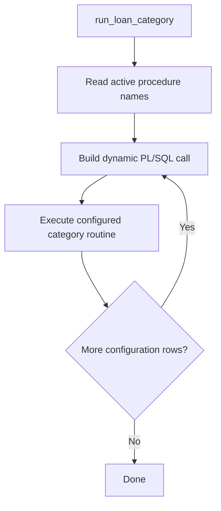
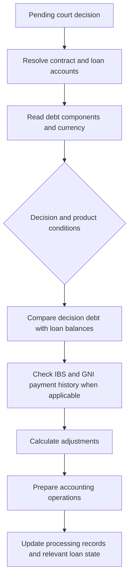
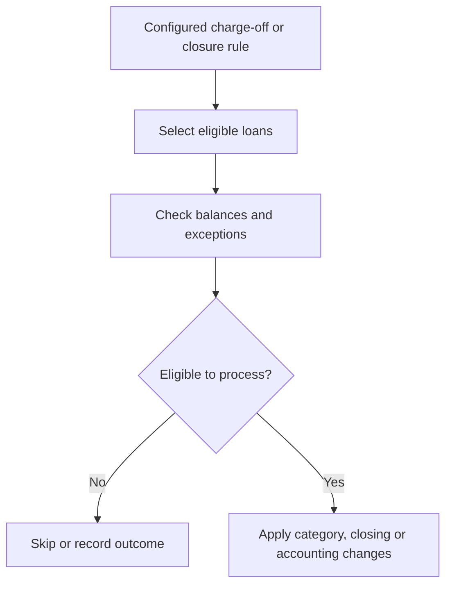
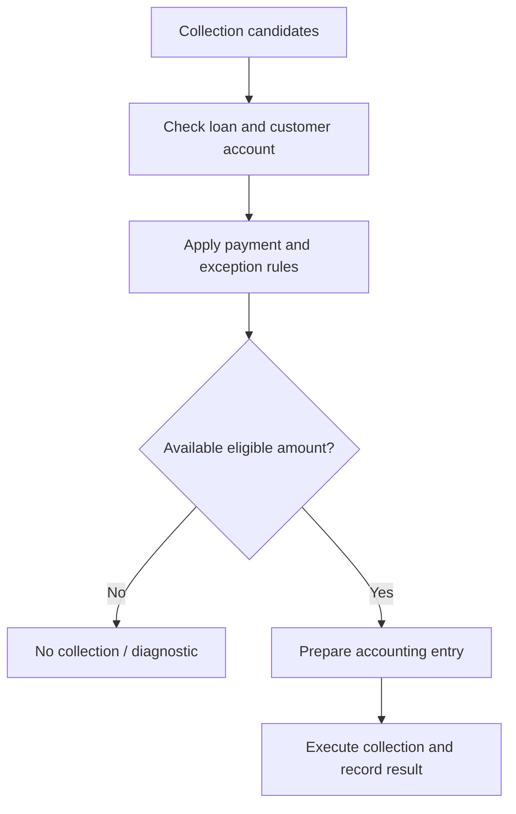

# LOAN_CATEGORY_API — Workflows

[← Overview](README.md) · [API Reference](api-reference.md) · [Data Model](data-model.md)

These diagrams summarize the business intent of **initially reviewed paths**. They are not a complete control-flow map of the long court-decision procedure.

## Configured category processing

## Court decision processing

## Charge-off and closing

## Payment collection

