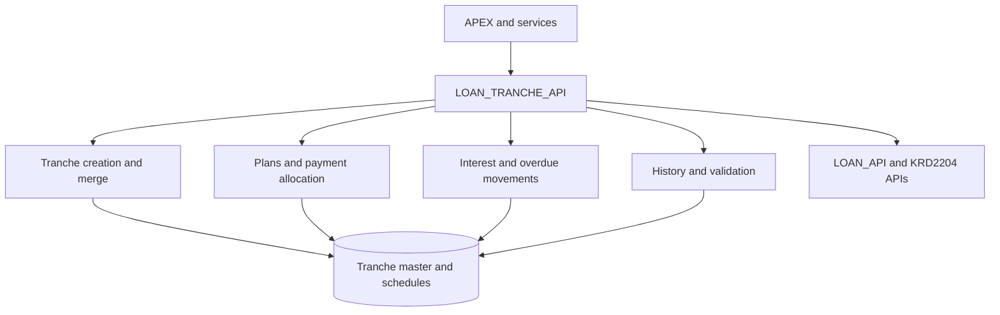

# LOAN_TRANCHE_API — Overview

[← Loan Management](../README.md)

`GAIA.LOAN_TRANCHE_API` provides tranche-specific loan processing for credit products, including loan cards and overdrafts (as stated in the package header). It coordinates tranche opening and merging, repayment plans, payment allocation, calculation of interest and penalties, overdue/transit transitions, audit logging, and reversals.

| Attribute | Value |
|---|---|
| Package | `GAIA.LOAN_TRANCHE_API` |
| Source | Supplied package specification and body |
| Public methods | **27: 18 procedures, 9 functions** |
| Implementation | 6,493-line body (includes private helpers) |
| Review status | Source-backed draft; confirm deployed code before release |

## Documentation

| Page | Description |
|---|---|
| [Workflows](workflows.md) | Visual tranche lifecycle, payments, interest and recovery |
| [Data Model](data-model.md) | Tranche/plan/history/configuration tables and relationships |
| [Dependencies](dependencies.md) | Shared APIs, KRD2204, product and account configuration |
| [API Reference](api-reference.md) | Every public signature, implementation summary, data access, validations, source location |
| [Error Handling](error-handling.md) | Common business validations and operational caveats |

## Functional areas

The **27 public interfaces** are grouped by primary business responsibility. Each area links to its corresponding API index section.

| Functional area | Purpose | Public methods | Reference |
|---|---|---:|---|
| **Tranche lifecycle** | Creation, execution and consolidation of tranche records. | 3 | [View methods](api-reference.md#domain-tranche-lifecycle) |
| **Payment schedules** | Generation, conversion and calculation of tranche repayment schedules. | 4 | [View methods](api-reference.md#domain-payment-schedules) |
| **Payments and allocation** | Allocation of loan-account payments among tranches and operation execution. | 3 | [View methods](api-reference.md#domain-payments-and-allocation) |
| **Interest and penalties** | Interest calculations and overdue penalty calculation inputs. | 3 | [View methods](api-reference.md#domain-interest-and-penalties) |
| **Overdue and transit** | Overdue/transit classification, movement processing and corrective postings. | 3 | [View methods](api-reference.md#domain-overdue-and-transit) |
| **Dates and loan lookup** | Loan record retrieval and configurable payment/overdue dates. | 4 | [View methods](api-reference.md#domain-dates-and-loan-lookup) |
| **History and reversal** | Tranche ledger history, logging, deletion and restoration. | 4 | [View methods](api-reference.md#domain-history-and-reversal) |
| **Integration and validation** | APEX view integration and tranche plan consistency checks. | 3 | [View methods](api-reference.md#domain-integration-and-validation) |

**Total: 27 public methods — 18 procedures and 9 functions.** These are documentation categories, not separate PL/SQL packages.

## Architecture

