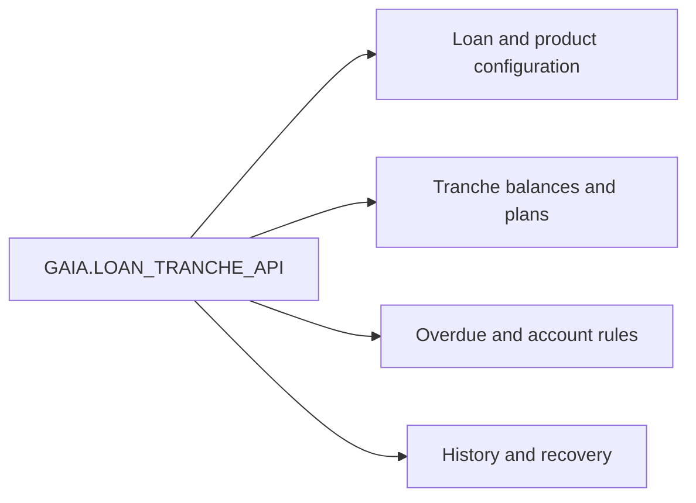
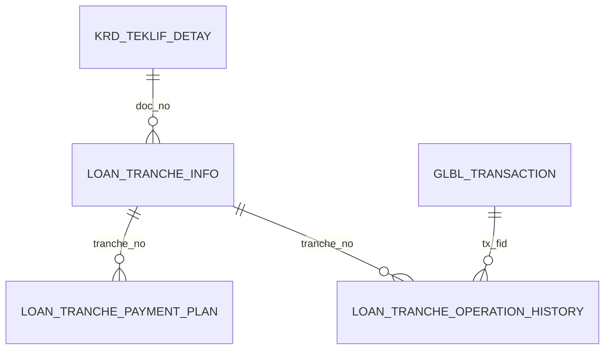

# LOAN_TRANCHE_API — Data Model & Database Access Register

[← Overview](README.md) · [API Reference](api-reference.md) · [Dependencies](dependencies.md) · [Workflows](workflows.md)

## Purpose and scope

This register summarizes the main data objects used in the supplied `GAIA.LOAN_TRANCHE_API` package specification and body, including objects accessed through private helpers that support the 27 public API entries. It explains **business roles and observable data access**, not the physical database schema. It is deliberately a *selected principal-object register*, not an exhaustive list of all SQL references, triggers or external package effects.

**Access legend:** `READ` denotes observed query access; `WRITE` denotes DML such as insert, update or delete in the package or its direct internal helpers. Both labels indicate possible operations, not a guarantee that every linked public method performs each access. Changes delegated to `LOAN_API`, KRD2204 or triggers are not included as direct writes here.

## Database access overview

| Measure | Documentation scope |
|---|---|
| Public API declarations | 27 (18 procedures, 9 functions) |
| Principal objects listed below | 20 |
| Business object groups | 4 |
| Physical primary/foreign keys | Not independently verified; database DDL required |

*Arrows represent business data areas, not physical foreign-key relationships.*

## Object inventory by business domain

### Loan master and product configuration

| Object | Observed access | Role in tranche processing | Related public API |
|---|---|---|---|
| `KRD_TEKLIF_DETAY` | READ, WRITE | Loan identity, contract, maturity, tranche flag, rates and conversion state. | [do_create_tranche](api-reference.md#do-create-tranche), [ovd_amount_correction](api-reference.md#ovd-amount-correction), [do_payment_plan_conversion](api-reference.md#do-payment-plan-conversion) |
| `KRD_ODEME_PLAN` | READ | Base repayment schedule used in tranche merge and conversion. | [do_merge_tranche](api-reference.md#do-merge-tranche), [do_payment_plan_conversion](api-reference.md#do-payment-plan-conversion) |
| `KRD_TESIS` | READ | Loan facility/account information selected in range-interest processing. | [do_int_calculation_by_range](api-reference.md#do-int-calculation-by-range) |
| `PKRD_TURKOD_PR` | READ | Product-level overdue thresholds, grace rules and schedule settings. | [get_ovd_date](api-reference.md#get-ovd-date), [ovd_amount_correction](api-reference.md#ovd-amount-correction) |
| `PKRD_ODETIP_PR` | READ | Pending product schedule-conversion mapping. | [do_payment_plan_conversion](api-reference.md#do-payment-plan-conversion), [ovd_amount_correction](api-reference.md#ovd-amount-correction) |

### Tranches and repayment schedules

| Object | Observed access | Role in tranche processing | Related public API |
|---|---|---|---|
| `LOAN_TRANCHE_INFO` | READ, WRITE | Per-tranche identifiers, dates and signed MAIN/INT/OVD/TRS/PEN amount buckets. | [create_tranche_history](api-reference.md#create-tranche-history), [create_tranche](api-reference.md#create-tranche), [do_merge_tranche](api-reference.md#do-merge-tranche) |
| `LOAN_TRANCHE_PAYMENT_PLAN` | READ, WRITE | Due/paid balances by account type and tranche; overdue/transit dates and closing state. | [get_plan_payment_amount](api-reference.md#get-plan-payment-amount), [distribute_payments_between_tranches](api-reference.md#distribute-payments-between-tranches), [ovd_amount_correction](api-reference.md#ovd-amount-correction) |
| `ODEME_PLAN_TMP` | READ, WRITE | Temporary generated schedule rows consumed during tranche correction and schedule creation. | [ovd_amount_correction](api-reference.md#ovd-amount-correction), [create_tranche](api-reference.md#create-tranche) |
| `LOAN_SCHEDULE_TYPES` | READ | Schedule type and payment/grace-period configuration. | [do_payment_plan_conversion](api-reference.md#do-payment-plan-conversion), [ovd_amount_correction](api-reference.md#ovd-amount-correction) |

### Overdue, interest and account rules

| Object | Observed access | Role in tranche processing | Related public API |
|---|---|---|---|
| `LOAN_TRANCHE_OVERDUE_TRANSIT_QUEUE` | READ, WRITE | Working list of classified OVERDUE/TRANSIT movements; populated by a private helper. | [do_overdue_transit_operation](api-reference.md#do-overdue-transit-operation) |
| `LOAN_ACC_TYPES_PR` | READ | Account groups, plan eligibility and allocation settings. | [get_plan_payment_amount](api-reference.md#get-plan-payment-amount), [distribute_payments_between_tranches](api-reference.md#distribute-payments-between-tranches) |
| `LOAN_TRANCHE_TYPES` | READ | Tranche ordering and payment priority configuration. | [distribute_payments_between_tranches](api-reference.md#distribute-payments-between-tranches) |
| `LOAN_TRANCHE_PERIODS` | READ | Period and date calculation rules. | [calculate_date](api-reference.md#calculate-date) |
| `LOAN_TRANCHE_PARAMETERS` | READ | Tranche term/type limits and creation configuration. | [create_tranche](api-reference.md#create-tranche) |
| `CS_ACCOUNT` | READ | Loan-linked bank account balances and posting account selection; actual posting delegated to LOAN_API. | [ovd_amount_correction](api-reference.md#ovd-amount-correction), [do_int_calculation_by_range](api-reference.md#do-int-calculation-by-range) |
| `EOD_PROGRAMS_EXCEPTION` | READ | Configured exclusions from certain batch selection flows. | [do_overdue_transit_operation](api-reference.md#do-overdue-transit-operation) |

### Transaction history and recovery

| Object | Observed access | Role in tranche processing | Related public API |
|---|---|---|---|
| `LOAN_TRANCHE_OPERATION_HISTORY` | READ, WRITE | Tranche-level transaction amount deltas and reversal basis. | [create_tranche_history](api-reference.md#create-tranche-history), [do_delete_operation](api-reference.md#do-delete-operation) |
| `LOAN_TRANCHE_INFO_LOG` | READ, WRITE | Transaction-linked snapshots of tranche state. | [table_log_operation](api-reference.md#table-log-operation), [do_delete_operation](api-reference.md#do-delete-operation) |
| `LOAN_TRANCHE_PAYMENT_PLAN_LOG` | READ, WRITE | Transaction-linked snapshots of plan rows for restoration. | [table_log_operation](api-reference.md#table-log-operation), [do_delete_operation](api-reference.md#do-delete-operation) |
| `GLBL_TRANSACTION` | READ | Transaction lookup and tranche execution correlation. | [do_create_tranche](api-reference.md#do-create-tranche), [do_delete_operation](api-reference.md#do-delete-operation) |

## Key logical joins

These are observed logical associations, **not** verified foreign-key declarations. `doc_no` generally selects a loan, `tranche_no` identifies a tranche, and `tx_fid` ties log/history operations to a transaction. Tranche creation updates master/plan rows; interest and overdue operations update balances and history; recovery reads `_LOG` state and historical movements.

## Reading this register

- A linked method is a representative entry point, not an exhaustive caller list. Internal routines may perform the actual SQL.
- Logical joins in the diagram do not establish database constraints, cardinalities or unique identifiers.
- Account postings may occur through `LOAN_API.do_journal_entry`; distinguish these from direct writes to tranche tables.
- Validate table/view/synonym types and constraints against the deployed schema before treating this as a physical ERD.
