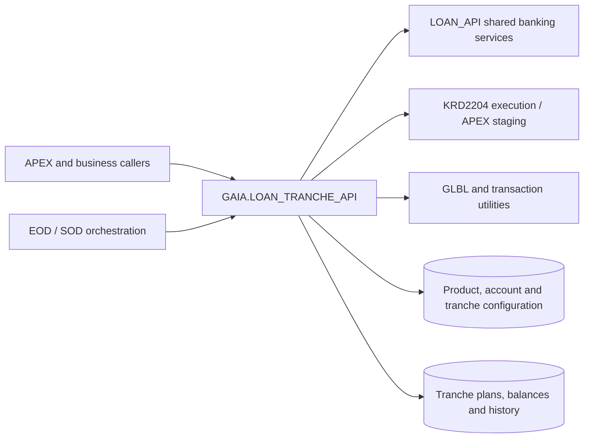

# LOAN_TRANCHE_API — Dependencies & Integration Map

[← Back to Overview](README.md)

## Scope

This document maps **named package and service dependencies** used by `GAIA.LOAN_TRANCHE_API` and explains why they matter to tranche processing. Its scope includes the 27 public declarations and source-visible supporting private routines.

**Evidence level:** entries represent source-visible qualified references or documented integration points. Links indicate representative public entry points, not a claim that every call is direct or unconditional. Source inspection alone cannot establish deployed grants, synonyms, object validity, transitive dependencies, or transaction ownership.

| Measure | Documentation result |
|---|---|
| Public API entries | 27 (18 procedures, 9 functions) |
| Principal external package/service entries below | 9 |
| Functional dependency domains | 2 service domains plus configuration |
| Runtime and compile-time dependency verification | Database metadata review required |

## Architecture and dependency domains



*These are logical integrations, not a full runtime call graph or a guarantee of transaction ordering.*

## Qualified service and package references

### Loan modules and APEX execution

| Qualified name | Functional responsibility / review note | Related public API |
|---|---|---|
| `LOAN_API` | Shared account and journal collection types; tranche payment allocation, schedule generation, amount-by-range calculation, postings, history, account-status mapping, interest-difference tracking. | [do_create_tranche](api-reference.md#do-create-tranche), [ovd_amount_correction](api-reference.md#ovd-amount-correction), [create_tranche_history](api-reference.md#create-tranche-history), [generate_allocated_payment_list](api-reference.md#generate-allocated-payment-list) |
| `KRD2204_0_API` | Execution context and validation/application of staged tranche operations. | [do_create_tranche](api-reference.md#do-create-tranche) |
| `APEX_KRD2204_0_API_P` | Staging and removing the KRD2204 transaction operation. | [do_create_tranche](api-reference.md#do-create-tranche) |
| `APEX_KRD2204_0_COLL_P` | Exposes the generated staged operation identifier. | [do_create_tranche](api-reference.md#do-create-tranche) |
| `LOAN_REPORT_API` | Supporting reporting/schedule metadata in internal plan-processing logic; exact call path requires source-level verification. | [do_payment_plan_creation](api-reference.md#do-payment-plan-creation) |

### Banking platform and transaction utilities

| Qualified name | Functional responsibility / review note | Related public API |
|---|---|---|
| `TRN_BROKER` | Transaction ID generation and operation correlation. | [do_create_tranche](api-reference.md#do-create-tranche), [ovd_amount_correction](api-reference.md#ovd-amount-correction) |
| `GLBL` | Logical system date (`GLBL.GETSYSDATE`) used as public parameter defaults and for calculations. | [get_plan_payment_amount](api-reference.md#get-plan-payment-amount), [do_int_calculation](api-reference.md#do-int-calculation) |
| `GLBL_TARIH` | Next-business-day and calendar utilities in interest and conversion processing. | [do_int_calculation_by_range](api-reference.md#do-int-calculation-by-range), [do_payment_plan_conversion](api-reference.md#do-payment-plan-conversion) |
| `GLBL_FAIZ` | Interest-related date/day-count support in calculation paths; confirm actual named calls against the deployed source. | [do_int_calculation](api-reference.md#do-int-calculation) |

## Source-visible internal orchestration

These are calls within the same package, not independent external package dependencies.

| Internal routine or interface | Relationship |
|---|---|
| `prepare_loans_for_ovd_trs` (private) | Builds the queue used in overdue/transit processing, invoking [get_ovd_trs_oper_type](api-reference.md#get-ovd-trs-oper-type) to classify amounts |
| `pen_main_correction` (private) | Reallocates principal-penalty amounts across tranche records and history |
| [calculate_date](api-reference.md#calculate-date) | Calculates the configured dates used by overdue/transit decisions |
| [create_tranche_history](api-reference.md#create-tranche-history) | Records transaction-level tranche amount changes and adjusts tranche state |
| [get_plan_error](api-reference.md#get-plan-error) / [do_plan_control](api-reference.md#do-plan-control) | Produces validation diagnostics and enforces a nonempty error result |

## Configuration and reference dependencies

The objects below are **database data/configuration objects**, not callable package dependencies. Detailed access roles belong in the [Data Model register](data-model.md).

| Object | Business role | Representative API |
|---|---|---|
| `PKRD_TURKOD_PR` | Product overdue thresholds and grace-period rules | [ovd_amount_correction](api-reference.md#ovd-amount-correction), [get_ovd_date](api-reference.md#get-ovd-date) |
| `LOAN_ACC_TYPES_PR` | Account groups, payable flags, and schedule eligibility | [get_plan_payment_amount](api-reference.md#get-plan-payment-amount), [distribute_payments_between_tranches](api-reference.md#distribute-payments-between-tranches) |
| `LOAN_TRANCHE_TYPES` | Tranche ordering/payment priority | [distribute_payments_between_tranches](api-reference.md#distribute-payments-between-tranches) |
| `LOAN_TRANCHE_PERIODS` | Date-period configuration | [calculate_date](api-reference.md#calculate-date) |
| `LOAN_TRANCHE_PARAMETERS` | Tranche creation settings | [create_tranche](api-reference.md#create-tranche) |
| `PKRD_ODETIP_PR`, `LOAN_SCHEDULE_TYPES` | Pending replacement schedule mapping | [do_payment_plan_conversion](api-reference.md#do-payment-plan-conversion), [ovd_amount_correction](api-reference.md#ovd-amount-correction) |
| `EOD_PROGRAMS_EXCEPTION` | Exclusion from selected EOD/batch loan processing | [do_overdue_transit_operation](api-reference.md#do-overdue-transit-operation) |

## Dependencies vs. database objects

- The **[Data Model](data-model.md)** records tranche tables, plan records and observed access roles.
- This page records **named code integrations** and important configuration dependencies.
- Public parameters expose `LOAN_API.G_LOAN_ACCOUNTS_TAB`; changes to this shared type can affect both packages' compilation or callers.
- Actual journal posting is delegated to shared services in some paths, so a direct update to a tranche balance must not be confused with the entire financial transaction.

## Oracle metadata verification

Check the actual package-body dependencies in the target schema:

```sql
SELECT referenced_owner, referenced_name, referenced_type
  FROM all_dependencies
 WHERE owner = :schema_name
   AND name = 'LOAN_TRANCHE_API'
   AND type = 'PACKAGE BODY'
 ORDER BY referenced_owner, referenced_type, referenced_name;
```

For invalid referenced objects:

```sql
SELECT d.referenced_owner,
       d.referenced_name,
       d.referenced_type,
       o.status
  FROM all_dependencies d
  LEFT JOIN all_objects o
    ON o.owner = d.referenced_owner
   AND o.object_name = d.referenced_name
   AND o.object_type = d.referenced_type
 WHERE d.owner = :schema_name
   AND d.name = 'LOAN_TRANCHE_API'
   AND d.type = 'PACKAGE BODY'
 ORDER BY d.referenced_name;
```

[← Back to Overview](README.md)
