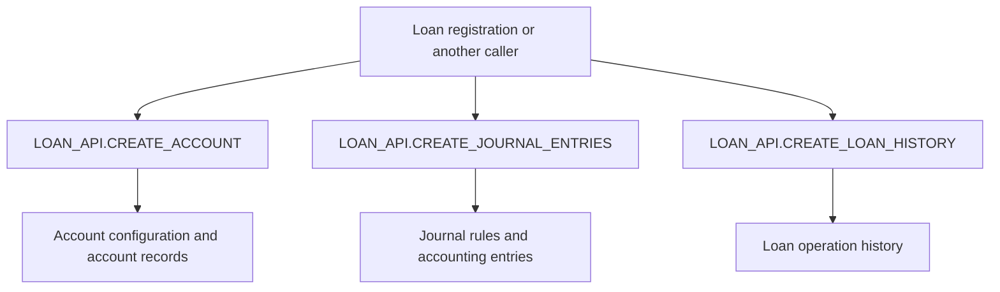
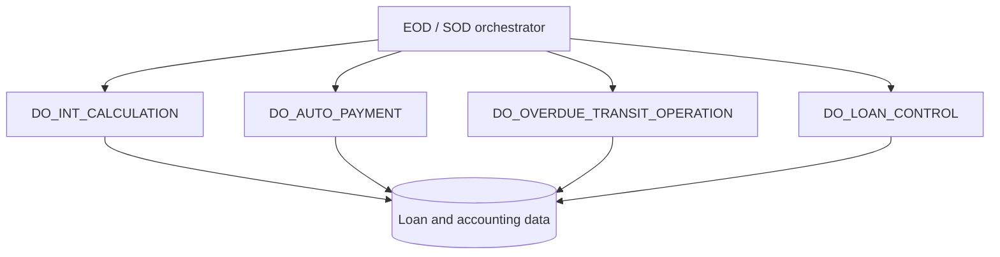
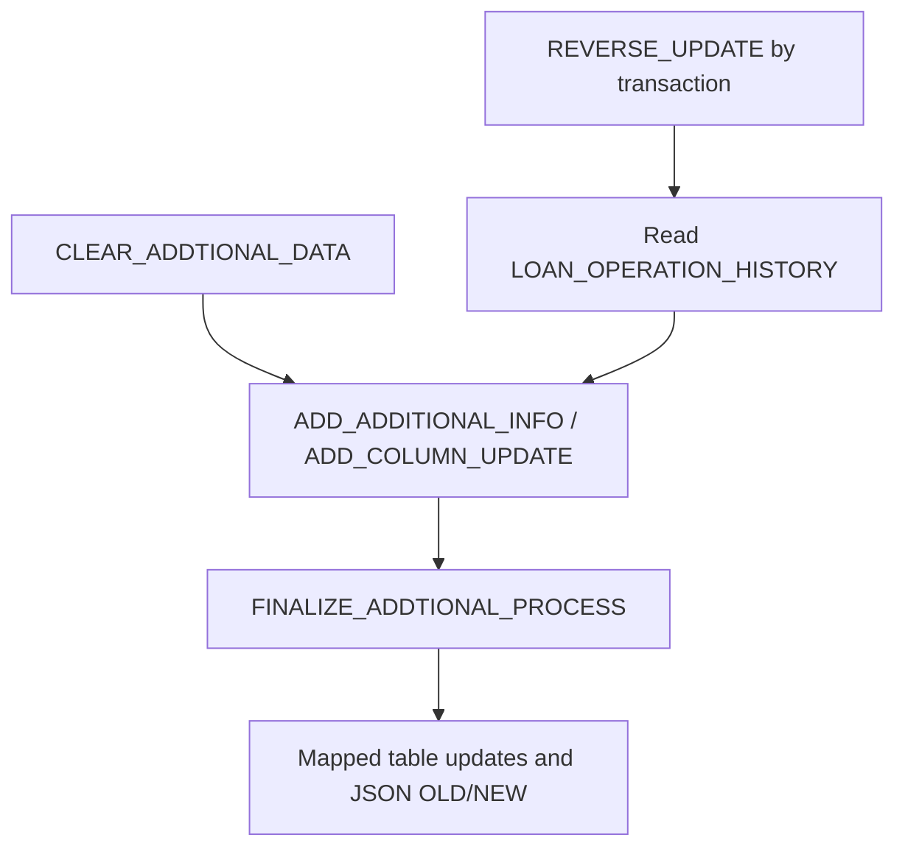

# LOAN_API — Cross-cutting Workflows

[← Documentation Home](index.md) · [API Reference](api.md) · [Data Model](data-model.md) · [Dependencies](dependencies.md)

This page provides a **high-level view** of the main areas where `GAIA.LOAN_API` participates. The diagrams group related public operations for architectural understanding; they **do not** prescribe a fixed sequence of calls or a complete runtime call graph.

## Workflow overview

| Area | What it covers |
|---|---|
| [Loan account creation and accounting](#loan-account-creation-and-accounting) | Account setup, accounting entries, and transaction history |
| [EOD / SOD processing](#eod--sod-processing) | Core end-of-day and start-of-day loan operations |
| [History and reversible mapped updates](#loan-history--reversible-mapped-updates) | Change metadata, mapped updates, and reversal |

## Loan account creation and accounting

These are **related capabilities**, not an assertion that every account-opening request invokes all three methods in this exact order. See [create_account](api.md#create-account), [create_journal_entries](api.md#create-journal-entries) and [create_loan_history](api.md#create-loan-history).

## EOD / SOD processing

**Important:** The package exposes these processing operations, but their scheduler-level execution order, concurrency and prerequisites are **not established** by this overview. See [do_int_calculation](api.md#do-int-calculation), [do_auto_payment](api.md#do-auto-payment), [do_overdue_transit_operation](api.md#do-overdue-transit-operation) and [do_loan_control](api.md#do-loan-control-1).

## Loan history / reversible mapped updates

The diagram summarizes related metadata and reversal capabilities. It is **not** a guarantee that reversal follows the normal forward-update path identically. See [finalize_addtional_process](api.md#finalize-addtional-process), [reverse_update](api.md#reverse-update) and [Data Model](data-model.md).

**Technical note:** Mapped updates use dynamic SQL in the implementation. Validate authorization, escaping, logging and transaction boundaries before exposing the operation to callers.

---

[← Back to Overview](index.md)
